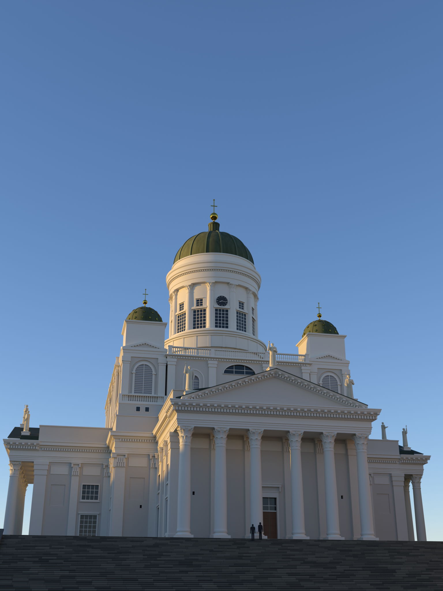

# 日落下的白教堂 · Helsinki Cathedral at Golden Hour (Blender / bpy)



参照一张在参议院广场台阶下、鎏金时刻拍的赫尔辛基大教堂（Helsingin tuomiokirkko）照片，
用 **纯 Python 程序化建模**（Blender `bpy` API，无任何外部模型或贴图）复现的场景：
希腊十字平面、南侧六柱科林斯门廊、四座镶金星的角塔、十二根壁柱的鼓座与铜绿穹顶、
十二使徒雕像、花岗岩大台阶，以及西面低角度的太阳与物理天空。

| 文件 | 说明 |
| --- | --- |
| `helsinki_cathedral.py` | **单文件版本**，直接在 Blender 里运行即可（见下文） |
| `helsinki_cathedral.blend` | 已生成好的场景（Blender 5.2 保存，含相机、太阳、天空、渲染设置，按 F12 即可渲染） |
| `renders/helsinki_cathedral_sunset.png` | 最终渲染 1536×2048，Cycles 512 采样 + 降噪 |
| `renders/compare_vs_photo.png` | 渲染与参考照片并排对比 |
| `renders/aerial_sw.png` | 西南高空检查视角（整体体量） |
| `src/` | 可维护的源码：共享几何库 `common.py`、五个模块 `mod_*.py`、集成入口 `main.py`、参数表 `spec.json`、打包器 `make_single_file.py`、参考照片缩略图 `ref/photo_small.jpg` |

## 怎么运行

**方式一：Blender 图形界面**（最简单）

1. 打开 Blender（5.x，实测 5.2 LTS；4.2+ 理论可用但未测试）。
2. 切到 *Scripting* 工作区 → *Text* → *Open* 选择 `helsinki_cathedral.py` → *Run Script*（Alt+P）。
3. 几秒后整座教堂就建在场景里了（1605 个物体 / 约 32.4 万面）。相机、太阳、天空、渲染参数（1536×2048，256 采样，Cycles）都已设好，按 **F12** 渲染。
   - 注意：脚本会用一个空白场景替换当前场景，请先保存你自己的工作。
   - 想让脚本运行后立刻渲染：把文件顶部的 `RENDER_ON_RUN = 'auto'` 改成 `True`（渲染期间界面会卡住，CPU 上约 5–20 分钟）。
   - 输出目录默认 `~/helsinki_cathedral_out/`，可用环境变量 `CATHEDRAL_OUT` 更改。

**方式二：命令行无界面渲染**

```bash
blender -b -P helsinki_cathedral.py -- --res 1536 2048 --samples 256 --out render.png --blend scene.blend
```

**方式三：不装 Blender，只装 bpy 轮子**

```bash
pip install bpy            # 需要 Python 3.11+（bpy 5.2 需要 3.13）
python helsinki_cathedral.py --res 1536 2048 --samples 256 --out render.png
```

参数：`--res W H` 分辨率（保持 3:4）、`--samples N` 采样数、`--out` 输出 PNG、`--blend` 同时保存 .blend、
`--aerial [--aerial-out 文件]` 额外渲一张西南高空视角、`--no-render` 只建模不渲染。
只支持 Cycles（EEVEE 不支持），CPU 渲染即可，无需显卡。

## 这个模型是怎么来的

1. **照片测量**：从照片里提取轮廓与边缘，用针孔相机 + 参数化建筑模型做最小二乘拟合
   （35 个未知量、约 75 个观测，残差 5.9 px），以十字架顶 62 m 为尺度锚点，解出相机位姿、
   各层标高、柱距、鼓座半径、塔的位置等；再结合建筑学知识（科林斯柱式比例、檐部三段、齿饰等）补足照片看不见的细节。
2. **绑定规格**：全部尺寸写进 `src/spec.json`（坐标约定：米，Z 向上，+X 东，+Y 北，原点在穹顶轴线、台阶顶面 z=0），
   并用 27 个照片特征点做投影校验（均方根 10.5 px）。
3. **分模块建模**：`mod_body`（墙体、窗、壁柱、阁楼）、`mod_portico`（四座门廊、科林斯柱、山花）、
   `mod_domes`（鼓座、穹顶、灯笼、金球十字、四角塔）、`mod_statues_site`（使徒、台阶、广场）、
   `mod_look`（材质升级、太阳与物理天空、相机、色彩管理、画外遮挡建筑的阴影）。
   重复构件（60 多根柱子、几百个齿饰、金星）都是链接复制，整场约 32.4 万面。
4. **多轮评审**：建筑、光影材质、技术三个视角各自对照照片找问题、量像素，再由修复者改模型，循环三轮；
   最后一轮精修台阶质感、穹顶肋条、灯笼、塔顶金星和浮雕板。

## 光照

- 太阳方位角 279°、仰角 6.5°（照片中西面被金光打亮、南面只有擦过的光，台阶与广场在西侧建筑的阴影里）。
- 天空使用 Blender 5 的物理天空（多次散射模型），加一盏暖色太阳灯；曝光 −2.5，Standard 视图变换。
- 画外用两块不可见的"遮挡建筑"复现照片里西侧建筑投在广场和左翼上的阴影，再用一块暖色反光板模拟东侧建筑的反射光。

## 已知差异

- 使徒雕像、柱头叶饰、浮雕板是风格化的简化几何，不是雕塑级细节。
- 穹顶铜绿在低角度阳光下比照片略亮、略偏青；照片右半边的斜向建筑阴影只做了近似。
- 没有人、树、路灯等环境元素（台阶上留了两个小人作比例参照）。

## 性能参考（4 核 CPU，无显卡）

| 步骤 | 耗时 |
| --- | --- |
| 建模（1605 个物体，约 32.4 万面） | 3.5 s |
| 预览 600×800，48 采样 | 约 14 s |
| 最终图 1536×2048，512 采样 + 降噪 | 12.4 min |

256 采样大约是上面的一半时间，画面差别很小；有显卡的话在 Blender 偏好设置里打开 GPU 即可成倍加速。
