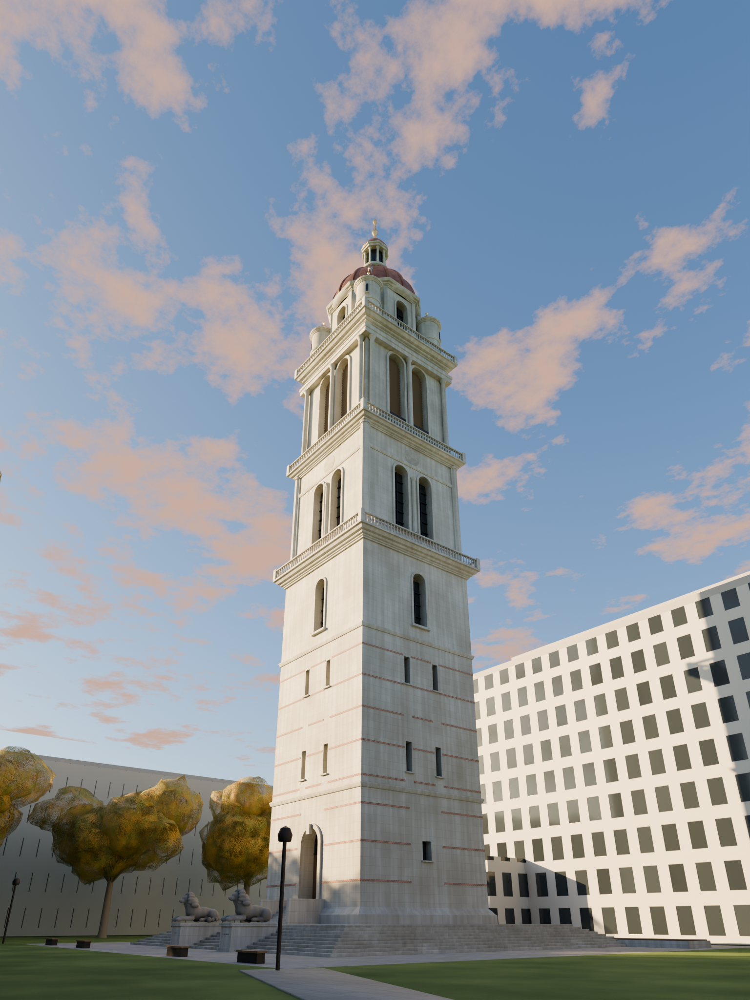

# Queen's Tower · Imperial College London（Blender / bpy）



从 Queen's Lawn 看 **Queen's Tower**：T. E. Collcutt 为 1887 年维多利亚女王金禧设计的 Imperial Institute
（1893 年落成）只剩下这一座 287 英尺（87 m）的塔——Portland 石、红砖细带、铜穹顶、十口 Alexandra Peal 的钟，
以及 1966–68 年拆除学院大楼后重砌的基座、宽台阶和两头从 Institute 正门搬来的石狮。
2022–2026 年大修刚结束（2026 年 4 月 21 日重新开放）：穹顶整个换了新铜皮，还没来得及发绿，
所以这版的穹顶是半年新的铜——暗红褐里透着一点亮，而不是大家照片里习惯的那层铜绿
（文件里留了 `M_Copper_verdigris` 材质，一键换回绿穹顶；命令行加 `--patina` 也行）。

**全程序化**：没有外部模型、贴图或字体，一个 Python 脚本从空场景生成一切——
塔的四段、三道栏杆回廊、钟楼百叶、八角鼓座、四角小塔和飞扶壁、十六道肋的穹顶、灯笼与鎏金尖顶，
石狮（元球雕塑转网格），草坪、Dangoor 广场、Imperial College Road 的悬铃木，
背景里 Sherfield 大楼、图书馆、化学楼的体量，以及十一月下午西南方向的低太阳和物理天空。

| 文件 | 说明 |
| --- | --- |
| `queens_tower.py` | **单文件脚本**，在 Blender 里 Run Script 即可重建整个场景（见下） |
| `queens_tower.blend` | 已生成好的场景（Blender 5.2 保存，含 4 个相机、天空、渲染设置，F12 直接渲） |
| `renders/queens_tower_lawn.png` | 主视角：Queen's Lawn 东南角，24 mm，1536×2048，Cycles 320 采样 + 降噪 |
| `renders/queens_tower_dome.png` | 100 mm 长焦看穹顶一段：八角鼓座、半圆小塔、飞扶壁、角塔、灯笼 |
| `renders/queens_tower_lions.png` | 南台阶脚下的两头狮子（景深） |
| `renders/queens_tower_aerial.png` | 西南高空检查视角（整体体量与校园关系） |

## 怎么运行

**方式一：Blender 图形界面**

1. 打开 Blender 5.x（实测 5.2 LTS）。
2. *Scripting* 工作区 → *Text* → *Open* 选 `queens_tower.py` → *Run Script*（Alt+P）。
3. 一两秒后塔就立在场景里了。相机 `cam_lawn` / `cam_dome` / `cam_lions` / `cam_aerial` 都在 `Studio` 集合，
   当前相机是 `cam_lawn`，按 **F12** 渲染（Cycles，CPU 可渲，4 核约 10–15 分钟）。
   - 脚本会用一个空场景替换当前场景，先存好自己的工作。
   - 想运行后立刻渲染：把文件顶部 `RENDER_ON_RUN = 'auto'` 改成 `True`。
   - 输出目录默认 `~/queens_tower_out/`，环境变量 `QT_OUT` 可改。

**方式二：命令行无界面**

```bash
blender -b -P queens_tower.py -- --res 1536 2048 --samples 256 --cam lawn --out qt.png --blend qt.blend
```

**方式三：不装 Blender，只装 bpy 轮子**

```bash
pip install bpy          # Blender 5.2 的 Python 模块，需要 Python 3.13
python queens_tower.py --res 1536 2048 --samples 256 --cam all
```

参数：`--cam lawn|dome|lions|aerial|all`、`--res W H`、`--samples N`、`--out 文件`、`--blend 文件`、
`--quick`（少一半的分段数，用来快速预览）、`--no-render`（只建模）、`--exposure EV`（默认 −3.0）、
`--sun-el 度 --sun-az 度`（默认仰角 17°、方位 232°，即十一月下午三点多的西南太阳）、`--patina`（铜绿穹顶）。
只支持 Cycles；EEVEE 在没有显卡的机器上会直接崩，合成器也已经强制 CPU。

## 塔是怎么搭的

坐标：米，Z 向上，+X 东，+Y 北，原点在塔轴线、广场地面 z = 0。尖顶 87.5 m。

| 标高 | 部位 |
| --- | --- |
| 0 → 1.5 | 1968 年重砌的基座：四面各 9 级台阶上到露台，再一道 1.1 m 的线脚座；南面一小段台阶上到门口 |
| 2.6 → 32.6 | **第一段**：12.7 m 见方的下部塔身，Portland 石大块砌体，165 mm 的红砖细带每 2.6 m 一道（在门洞和窗处断开），南面一个不大的圆拱门（木门 + 扇形亮子），每面两对窄缝窗、两道腰线，回廊下面一扇拱窗；顶上第一道栏杆回廊 |
| 32.7 → 45.6 | **第二段**：收到 11.9 m，每面一对 7.2 m 高的拱窗夹一根小柱，上有圆窗；四角八角形附壁小柱；第二道回廊 |
| 45.7 → 59.6 | **第三段（钟楼）**：11.2 m 见方，每面两个 9.3 m 高的拱形百叶窗，三根托斯卡纳柱托着檐部；里面挂着五口钟当影子；第三道回廊 = 324 级台阶上来的观景廊 |
| 59.7 → 68.4 | **第四段**：八角鼓座几乎和钟楼一样宽（对边 9.8 m），正交四面开大拱窗；对角四面各一座半圆小塔（Ø 2.7 m）抱住塔身四角，顶着矮矮的铜皮小穹顶和鎏金尖；每座小塔檐口上伸出一道弧形飞扶壁，斜撑在大穹顶上 |
| 68.7 → 75.9 | 铜穹顶：直径 10.6 m，饱满、只略带一点尖，十六道立肋 |
| 75.9 → 87.5 | 八柱灯笼亭（3.2 m 高的拱廊）、小铜顶、鎏金球与尖顶 |

比例依据：塔高 287 ft、Historic England 列表描述（"Portland stone with red brick bands; copper dome;
four main stages separated by balustraded balconies; dome with octagonal stage beneath having semicircular
turrets and flying buttresses above four corners of tower"）、"324 steps to the base of the dome"，
以及对这座塔的印象。各段的宽度和标高是按这些约束推的，不是测绘值——
它是一座"像 Queen's Tower 的塔"，不是毫米级复刻；要改比例，所有尺寸都在脚本顶部 `H1/H2/H3/Z_*` 那一组常量里。

几何全用 `bmesh` 和自己写的小工具生成：`lathe`（旋转体：柱、栏杆柱、穹顶、灯笼、尖顶）、
`sweep_ngon`（把线脚剖面沿方形/八角形扫一圈：檐口、腰线、台阶、砖带）、`arch_surround`（拱券线脚）、
`boolean_cut`（精确布尔开窗，一次合并一段所有的切割体）、`sweep_rect_along`（飞扶壁、树枝、小路）、
`balustrade`（栏杆：栏杆柱用链接复制共享网格）。每一面的装饰只建南面一套，再绕塔轴转到另外三面。

石狮是 Blender 的元球（metaball）堆出来的雕塑再转成网格：卧姿、挺胸、抬头平视，身体、胸、头、
鬃毛（两圈"发绺"）、四肢、尾巴；东边那头是西边那头的镜像，成对。元球在硬度 10、阈值 0.6 下
可见半径只有元球半径的 0.78 倍，脚本里按这个系数放大了尺寸。两头狮子各立在 1.6 m 高的素面基座上，
基座正面各刻了一行小字，从草坪那边看得见。

过程里做过一轮独立评审（只凭记忆、不看照片，对照真塔挑最显眼的偏差），据此改了：鼓座加宽到接近塔身、
角塔从细瘦的尖塔改成抱角的半圆墩塔、穹顶从葱形改成饱满略尖、铜色从粉改成哑光褐、下部塔身去掉过多的大拱门
只留一个门、狮子抬头并换成镜像对、悬铃木长到 20–25 m。

材质也都是节点程序化：Portland 石用 Brick 纹理做砌块缝（向量用 (x+y, z) 投影，这样 ±X 和 ±Y 四个面都是水平砌缝）、
低频噪声做色差、AO 节点把檐口下面熏暗；铜用噪声在"暗红氧化"和"亮铜"之间过渡并顺带控制粗糙度；
草坪、York 石板、花岗岩小料石、1960 年代格栅幕墙（Sherfield / 图书馆）各一套。

天空：Sky Texture（Multiple Scattering），太阳仰角 17°、方位 232°（顺时针自北起），气溶胶密度 3.2 让光更暖更柔；
带太阳盘的物理天空非常亮，曝光设在 −3.0 EV。云是 1400 m 高空一张用噪声抠出透明度的自发光平面（不投影）。

## 已知的简化

- 塔的各段比例是推算的；下部塔身的开窗布置、鼓座小塔的具体样式凭印象。
- Sherfield、图书馆、化学楼、Royal School of Mines 只有体量 + 格栅材质，位置示意。
- 悬铃木是噪声变形的球体加透明噪声，远看是秋天的树，近看不是。
- 狮子是元球雕塑，远看是狮子，近看像大型猫科布偶。
